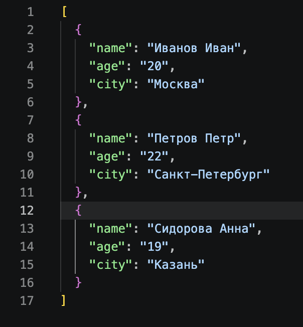
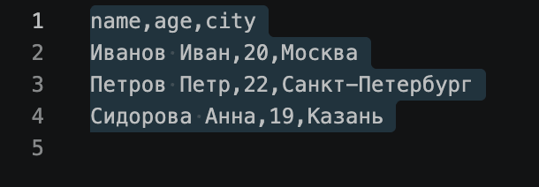
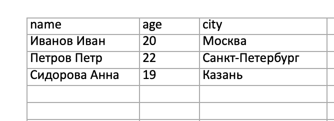

# Лабораторная работа №5 — Конвертация данных (JSON, CSV, XLSX)

## Цель работы
Изучить работу с табличными и структурированными форматами данных в Python (`json`, `csv`, `openpyxl`), реализовать функции взаимной конвертации `JSON ↔ CSV` и экспорта `CSV → XLSX` с проверкой корректности входных данных и настройкой форматирования таблиц Excel.

## Задание A — JSON ↔ CSV
### Преобразует JSON-файл в CSV
неверный тип файла, пустой JSON или CSV → ValueError.
осутствующий файл → FileNotFoundError

```Python
import json
import csv
import os 

def json_to_csv(json_path: str, csv_path: str) -> None:
    """
    Преобразует JSON-файл в CSV.
    Поддерживает список словарей [{...}, {...}], заполняет отсутствующие поля пустыми строками.
    Кодировка UTF-8.
    """
    if not os.path.exists(json_path):
        raise FileNotFoundError(f"Файл не найден: {json_path}")

    try:
        with open(json_path, 'r', encoding='utf-8') as f:
            data = json.load(f)
    except json.JSONDecodeError as e:
        raise ValueError(f"Битый JSON: {e}")

    if not data:
        raise ValueError("JSON пустой")

    if not isinstance(data, list) or not all(isinstance(item, dict) for item in data):
        raise ValueError('Ожидается список словарей в JSON')

    fieldnames = list(data[0].keys())

    with open(csv_path, 'w', encoding='utf-8', newline='') as f:
        writer = csv.DictWriter(f, fieldnames=fieldnames)
        writer.writeheader()
        writer.writerows(data)
```


### Преобразует файл JSON в CSV
неверный тип файла, пустой JSON или CSV → ValueError.
осутствующий файл → FileNotFoundError
```python
def csv_to_json(csv_path: str, json_path: str) -> None:
    """
    Преобразует CSV в JSON (список словарей).
    Заголовок обязателен, значения сохраняются как строки.
    json.dump(..., ensure_ascii=False, indent=2)
    """
    if not os.path.exists(csv_path):
        raise FileNotFoundError(f'Файл не найден: {csv_path}')

    data = []
    with open(csv_path, 'r', encoding='utf-8', newline='') as f:
        reader = csv.DictReader(f)
        if not reader.fieldnames:
            raise ValueError("CSV пустой или отсутствует заголовок")

        for row in reader:
            data.append(row)

        if not data:
            raise ValueError("CSV пустой")

        with open(json_path, 'w', encoding='utf-8', newline='') as f:
            json.dump(data, f, ensure_ascii=False, indent=2)

if __name__ == "__main__":
    json_to_csv("data/samples/people.json", "data/out/people_from_json.csv")
    csv_to_json("data/samples/people.csv", "data/out/people_from_csv.json")
```
## Тест кейсы для - А
JSON -> CSV

Input
``` JSON
[
  {
    "name": "Иванов Иван",
    "age": "20",
    "city": "Москва"
  },
  {
    "name": "Петров Петр",
    "age": "22",
    "city": "Санкт-Петербург"
  },
  {
    "name": "Сидорова Анна",
    "age": "19",
    "city": "Казань"
  }
]
```

Output
```CSV
name,age,city
Иванов Иван,20,Москва
Петров Петр,22,Санкт-Петербург
Сидорова Анна,19,Казань
```

CSV -> JSON
Input
```CSV
name,age,city
Иванов Иван,20,Москва
Петров Петр,22,Санкт-Петербург
Сидорова Анна,19,Казань
``` 

Output
``` JSON
[
  {
    "name": "Иванов Иван",
    "age": "20",
    "city": "Москва"
  },
  {
    "name": "Петров Петр",
    "age": "22",
    "city": "Санкт-Петербург"
  },
  {
    "name": "Сидорова Анна",
    "age": "19",
    "city": "Казань"
  }
]
``` 

# 
# 

## Задание B — CSV → XLSX

### Конвертирует CSV в XLSX, использует openpyxl
Проверка ошибок:
    неверный тип файла, пустой JSON или CSV → ValueError.
    осутствующий файл → FileNotFoundError

```python
import csv
import os
from openpyxl import Workbook

def csv_to_xlsx(csv_path: str, xlsx_path: str) -> None:
    """
    Конвертирует CSV в XLSX.
    Первая строка CSV — заголовок.
    Лист называется "Sheet1".
    Колонки — автоширина по длине текста (не менее 8 символов).
    """
    if not os.path.exists(csv_path):
        raise FileNotFoundError(f"Файл не найден: {csv_path}")

    wb = Workbook()
    ws = wb.active
    ws.title = "Sheet1"

    with open(csv_path, 'r', encoding='utf-8', newline='') as f:
        reader = csv.reader(f)
        data = list(reader)

    if not data:
        raise ValueError("CSV пустой")

    for row in data:
        ws.append(row)

    for col in ws.columns:
        max_length = 0
        column_letter = col[0].column_letter

        for cell in col:
            if cell.value:
                length = len(str(cell.value))
                if length > max_length:
                    max_length = length
        ws.column_dimensions[column_letter].width = max(max_length + 2, 8)

    os.makedirs(os.path.dirname(xlsx_path), exist_ok=True)
    wb.save(xlsx_path)

if __name__ == "__main__":
    csv_path = "data/samples/people.csv"
    out_dir = "data/out"
    csv_to_xlsx(csv_path, f"{out_dir}/people.xlsx")
``` 

Test-Case

input
``` CSV
name,age,city
Иванов Иван,20,Москва
Петров Петр,22,Санкт-Петербург
Сидорова Анна,19,Казань
``` 

output
# 