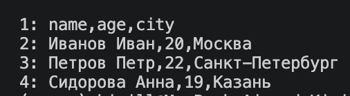
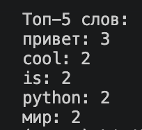
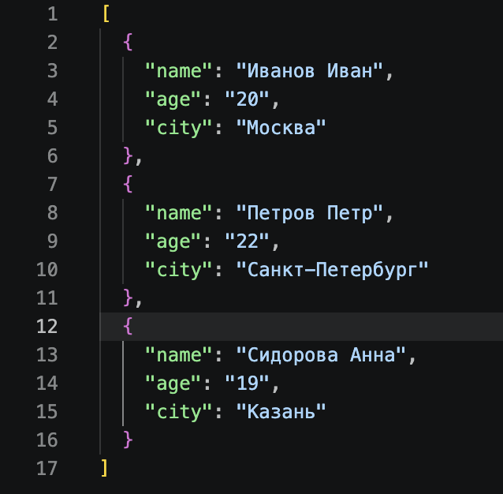
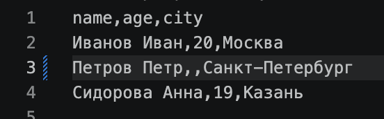
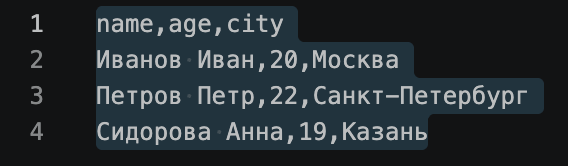
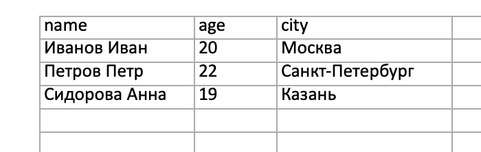
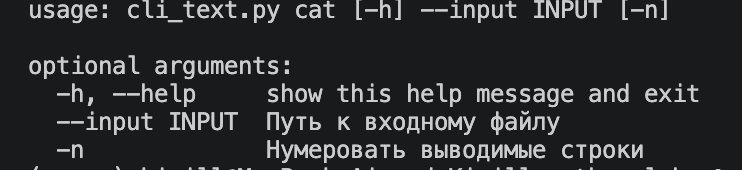
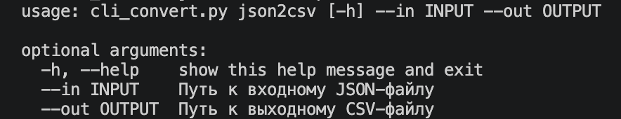
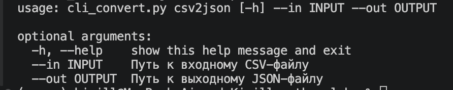
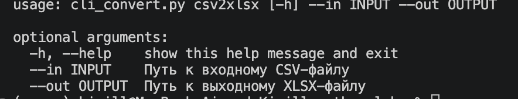

# ЛР6 - CLI‑утилиты с argparse (cat/grep‑lite + конвертеры): Техническое задание

## Цель: Научиться создавать консольные инструменты с аргументами командной строки, подкомандами и флагами.

### Задание 1 - CLI-утилита для текста (`src/lab06/cli_text.py`)

 Выводит содержимое файла построчно (с нумерацией при флаге -n)

```python
import argparse
from pathlib import Path

def cmd_cat(input_path: str, number_lines: bool) -> None:

    path = Path(input_path)
    if not path.is_file():
        raise FileNotFoundError(f"Файл не найден: {input_path}")

    with open(path, "r", encoding="utf-8") as f:
        lineno = 1
        for line in f:
            clean_line = line.rstrip("\n")
            if number_lines:
                print(f"{lineno}: {clean_line}")
            else:
                print(clean_line)
            lineno += 1
```

Анализирует частоты слов в тексте и выводит топ-N

```python
def cmd_stats(input_path: str, top: int) -> None:

    path = Path(input_path)
    if not path.is_file():
        raise FileNotFoundError(f"Файл не найден: {input_path}")

    text = path.read_text(encoding="utf-8")
    tokens = tokenize(normalize(text))
    freqs = count_freq(tokens)

    print(f"Всего слов: {len(tokens)}")
    print(f"Уникальных слов: {len(freqs)}")
    print(f"Топ-{top} слов:")
    for word, count in top_n(freqs, top):
        print(f"{word}: {count}")
```

```python
def main() -> None:
    parser = argparse.ArgumentParser(description="CLI-утилита для работы с текстом (cat и stats)")
    subparsers = parser.add_subparsers(dest="command", required=True, help="Доступные подкоманды")


    cat_parser = subparsers.add_parser("cat", help="Вывести содержимое файла построчно")
    cat_parser.add_argument("--input", required=True, help="Путь к входному файлу")
    cat_parser.add_argument("-n", action="store_true", help="Нумеровать выводимые строки")


    stats_parser = subparsers.add_parser("stats", help="Посчитать статистику и частоты слов")
    stats_parser.add_argument("--input", required=True, help="Путь к текстовому файлу")
    stats_parser.add_argument("--top", type=int, default=5, help="Количество самых частых слов (по умолчанию: 5)")
    args = parser.parse_args()

    if args.command == "cat":
        cmd_cat(args.input, args.n)
    elif args.command == "stats":
        if args.top <= 0:
            parser.error("Параметр --top должен быть положительным целым числом")
        cmd_stats(args.input, args.top)
```

cat --input data/samples/people.csv -n
# 

stats --input data/samples/people.txt --top 5
# 


### Задание 2 - cli_convert - консольный конвертер форматов

Переиспользует функции json_to_csv, csv_to_json и csv_to_xlsx из пакета src.lab05 и оборачивает их в три подкоманды

```python
import argparse
from pathlib import Path
from src.lab05.json_csv import json_to_csv, csv_to_json
from src.lab05.csv_xlsx import csv_to_xlsx


def main() -> None:
    parser = argparse.ArgumentParser(description="CLI-конвертер табличных и структурированных данных (JSON, CSV, XLSX)")
    sub = parser.add_subparsers(dest="cmd", required=True, help="Режим конвертации")

    p1 = sub.add_parser("json2csv", help="Конвертировать JSON в CSV")
    p1.add_argument("--in", dest="input", required=True, help="Путь к входному JSON-файлу")
    p1.add_argument("--out", dest="output", required=True, help="Путь к выходному CSV-файлу")

    p2 = sub.add_parser("csv2json", help="Конвертировать CSV в JSON")
    p2.add_argument("--in", dest="input", required=True, help="Путь к входному CSV-файлу")
    p2.add_argument("--out", dest="output", required=True, help="Путь к выходному JSON-файлу")

    p3 = sub.add_parser("csv2xlsx", help="Конвертировать CSV в XLSX")
    p3.add_argument("--in", dest="input", required=True, help="Путь к входному CSV-файлу")
    p3.add_argument("--out", dest="output", required=True, help="Путь к выходному XLSX-файлу")

    args = parser.parse_args()

    in_path = Path(args.input)
    if not in_path.is_file():
        raise FileNotFoundError(f"Файл не найден: {args.input}")

    out_path = Path(args.output)
    out_path.parent.mkdir(parents=True, exist_ok=True)

    if args.cmd == "json2csv":
        json_to_csv(str(in_path), str(out_path))
        print(f"Успешно: {in_path} -> {out_path}")

    elif args.cmd == "csv2json":
        csv_to_json(str(in_path), str(out_path))
        print(f"Успешно: {in_path} -> {out_path}")
        
    elif args.cmd == "csv2xlsx":
        csv_to_xlsx(str(in_path), str(out_path))
        print(f"Успешно: {in_path} -> {out_path}")


if __name__ == "__main__":
    main()
```

### JSON в CSV
in:
# 

out:
# 


### CSV в JSON
in:
# 

out:
# 


### CSV XLSX
in:
# 

out:
# 


python3 -m src.lab06.cli_text cat --help
# 

python3 -m src.lab06.cli_text stats --help
# 

python3 -m src.lab06.cli_convert json2csv --help
# 

python3 -m src.lab06.cli_convert csv2json --help
# 

python3 -m src.lab06.cli_convert csv2xlsx --help
# 
