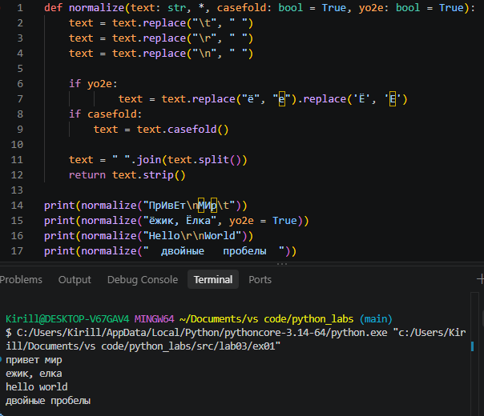
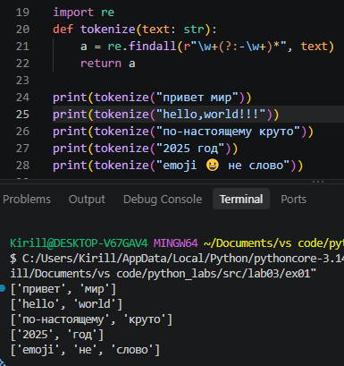
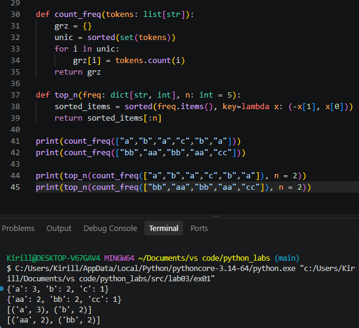
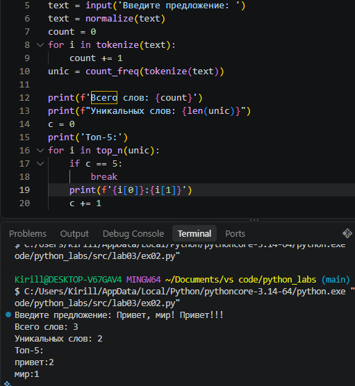

# **Лабораторные работы по Python**

## ***Лабораторная работа №3***

### Задание A

#### **normalize**

#### Заменяет ё/Ё на е/Е
#### Заменяет управляющие символы на пробел
#### "Схлопывает" последовательности пробелов в один

# 

#### **tokenize**

#### Токенизация. Множество слов — это все подстроки, удовлетворяющие шаблону \w+(?:-\w+)* (буквы/цифры/подчёркивание; допускается дефис внутри слова), разделённые любыми не-\w символами.

# 

#### **count_freq + top_n**

#### Частоты. Для списка токенов T = [t₁, …, tₙ] частота слова w равна f(w) = |{ i : tᵢ = w }|.

#### Top-N. Отсортировывает пары на слово и частоту по ключу (-частота, слово) и берутся первые N.

# 

### Задание B

#### Импортируется библиотека из .../python_labs/src/lib/text.py, читает строку, вызывает функции оттуда и считает общее количество слов, количество уникальных слов, выводит топ-5 самых частых слов.

# 
