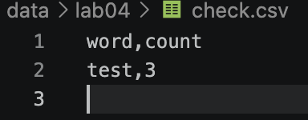
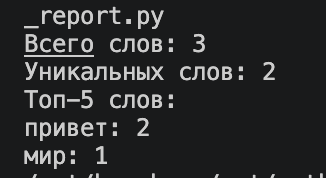
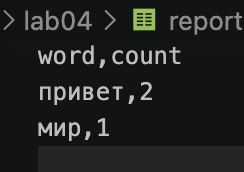
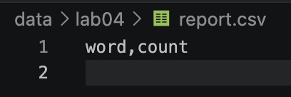
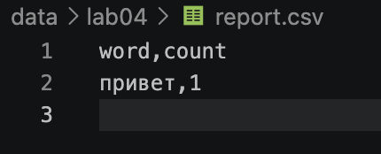

# **Лабораторные работы по Python**

## ***Лабораторная работа №4***

### Задание A

```python
import csv
from pathlib import Path
from typing import Iterable, Sequence

Функция читает текстовый файл и возвращает в виде 1-й строки. По умолчанию стоит кодировка utf-8. Внутри функции создается объект Path из переданного пути. Если файл не найден или кодировка не та, то всплавают FileNotFoundError / UnicodeDecodeError

def read_text(path: str | Path, encoding: str = "utf-8") -> str:
    """
    функция для чтения текстового файла в виде строки
    по умолчанию используется кодировка utf-8
    если файл сохранен в другой кодировке, то нужно указать её в параметре encoding (пример: encoding="cp1251")
    """
    p = Path(path)
    return p.read_text(encoding=encoding)
```

Функция принимает на вход путь к файлу в виде строки или объекта Path. Далее переводит объект в список. Затем проверяет все ли строки одной длины(в том числе загаловок), если нет то выводит ошибку. Открывет файл с помощью p.open. Испоьзует csv.writer(), записывает заголовок , после в цикле записывает в файл каждую строку.

```python
def write_csv(rows: Iterable[Sequence], path: str | Path,
              header: tuple[str, ...] | None = None) -> None:
    p = Path(path)
    rows = list(rows)
    for i in rows:
        if len(i) != len(rows[0]):
            raise ValueError('Количество элементов в строках не совпадает')
    if rows and header is not None and len(header) != len(rows[0]):
        raise ValueError('Количество элементов в заголовке не совпадает с количеством элементов в строках')
    
    with p.open("w", newline="", encoding="utf-8") as f:
        w = csv.writer(f)
        if header is not None:
            w.writerow(header)
        for r in rows:
            w.writerow(r)
```
Мини-тесты:

```python
from io_txt_csv import read_text, write_csv
txt = read_text("data/lab04/input.txt")  # должен вернуть строку
write_csv([("word","count"),("test",3)], "data/lab04/check.csv")  # создаст CSV
```

Вывод:

# 

### Задание B

Скрипт читает входной файл, путь к файлу захардкожен. Если файла нет, код заканчивается единицей и выводится ошибка. Также нормализует текст (lib/text.py), токенизирует и считает частоты слов. Сохраняет data/report.csv c колонками: word,count, отсортированными: count ↓, слово ↑ (при равенстве). В консоль выводит: кол-во слов; Уникальных слов и Топ-5 из ЛР3

```python
from src.lab04.io_txt_csv import read_text, write_csv
from src.lib.text import normalize, tokenize, count_freq, top_n
import sys

try:
    txt = read_text("data/lab04/input.txt")
except FileNotFoundError:
    print("Файл не найден")
    sys.exit(1)

freq_txt = count_freq(tokenize(normalize(txt)))
sorted_txt = sorted(freq_txt.items(), key=lambda x: (-x[1], x[0]))
write_csv(sorted_txt, "data/lab04/report.csv", header=["word", "count"])

print(f'Всего слов: {len(tokenize(normalize(txt)))}')
print(f"Уникальных слов: {len(count_freq(tokenize(normalize(txt))))}")
print(f"Топ-5 слов:")
for word, count in top_n(freq_txt, 5):
    print(f"{word}: {count}")
```
## Тест‑кейсы (минимум)

### A. Один файл (база)

Консоль:
# 

report.csv:
# 

Пустой файл:
# 

Кодировка cp1251:
# 